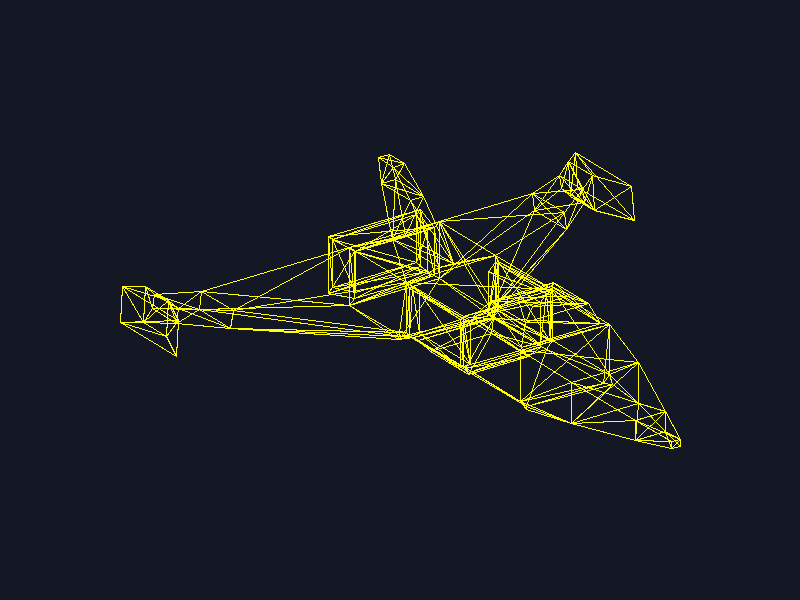

# Lab 4: Modelo OBJ con triángulos

Primer ejercicio del proyecto 1 de Gráficas. El programa carga la nave modelada en el lab 3 (`models/nave.obj`) y la dibuja en pantalla con un software renderer escrito en C++ con SDL2 y glm. Cada cara del modelo se dibuja con la función propia `triangle`, que traza sus tres aristas con Bresenham.

## Resultado



La imagen [`render.png`](render.png) mide `800 × 600` píxeles. El modelo queda centrado en la pantalla y ocupa el 70 % del ancho, sin salirse de los bordes.

## Cómo funciona

1. `loadOBJ` lee el archivo línea por línea:
   - Las líneas `v` se guardan como vértices (`glm::vec3`).
   - Las líneas `f` se guardan como caras con los índices de sus vértices. El OBJ empieza a contar desde 1, por eso se resta 1 a cada índice.
2. `prepareVertices` convierte cada vértice a coordenadas de pantalla una sola vez:
   - Mueve el centro del modelo al origen.
   - Lo gira con una rotación fija (yaw −145°, pitch 25°) para verlo en tres cuartos, como en el render del lab 3.
   - Lo escala para que quepa en el 70 % de la pantalla sin deformarse.
   - Lo mueve al centro de la ventana e invierte el eje `y`, porque en pantalla crece hacia abajo.
3. `render` recorre manualmente las caras, toma los tres índices de cada una y con ellos obtiene los tres vértices del triángulo:

```cpp
for (const Face& face : faces) {
    glm::vec3 v1 = screenVertices[face.vertexIndices[0]];
    glm::vec3 v2 = screenVertices[face.vertexIndices[1]];
    glm::vec3 v3 = screenVertices[face.vertexIndices[2]];
    triangle(v1, v2, v3);
}
```

4. `triangle` dibuja las tres aristas con `line`, que usa Bresenham y pinta cada punto en el framebuffer.
5. `renderBuffer` copia el framebuffer a una textura de SDL y la muestra en la ventana.

## Estructura

```text
.
├── CMakeLists.txt
├── README.md
├── render.png
├── models
│   ├── nave.obj           # Modelo del lab 3
│   └── nave.mtl
└── src
    ├── main.cpp           # Ventana, preparación de vértices y recorrido de caras
    ├── color.h            # Color RGBA
    ├── framebuffer.h/.cpp # Píxeles, clear, point, renderBuffer y savePNG
    ├── line.h/.cpp        # Líneas con Bresenham
    ├── triangle.h/.cpp    # Triángulo formado por tres líneas
    └── obj_loader.h/.cpp  # Lectura de vértices y caras del OBJ
```

## Requisitos

- CMake 3.24 o superior.
- Compilador de C++17 (probado con Visual Studio 2022).
- Git y conexión a internet la primera vez que se configura el proyecto.

No hay que instalar nada más. CMake descarga y compila automáticamente las dependencias en versiones fijas:

| Dependencia | Versión | Uso |
|---|---|---|
| SDL2 | `release-2.32.10` | Ventana y textura |
| glm | `1.0.3` | Vectores y rotación |
| stb | `a7d4c21` | Guardar el PNG (`stb_image_write.h`) |

## Ejecución

Desde la raíz del proyecto:

```powershell
cmake -S . -B build
cmake --build build --config Release
.\build\Release\software_renderer.exe
```

Controles de la ventana:

| Tecla | Acción |
|---|---|
| `S` | Guarda el frame actual como `render.png` en la carpeta desde donde se ejecutó el programa |
| Cerrar ventana | Termina el programa |

Para volver a generar la imagen sin abrir la ventana:

```powershell
.\build\Release\software_renderer.exe --screenshot render.png
```

## Verificación

- El cargador lee 142 vértices y 325 caras de `nave.obj`.
- El proyecto compila sin advertencias en el código propio (`/W4`).
- En `render.png`, el modelo ocupa de `x = 120` a `x = 680` y de `y = 152` a `y = 448`, con su centro exactamente en `(400, 300)`.
